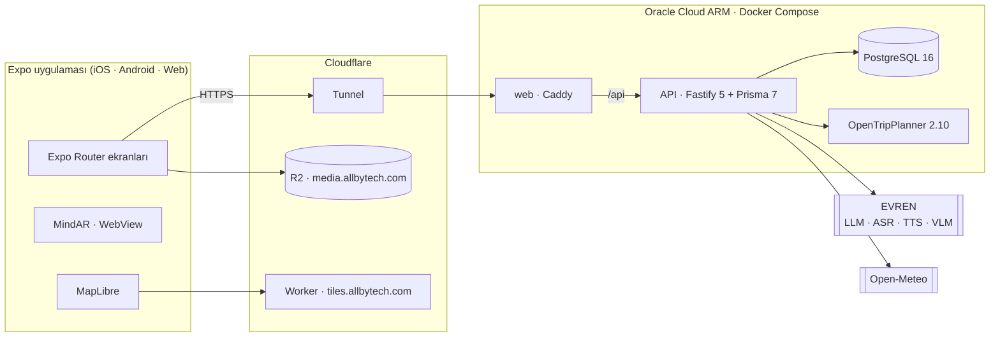

# Vakıfname

[](https://github.com/Myxoceph/RootNCode-Hackathon/actions/workflows/ci.yml)

**Vakıf eserlerini ziyaret edilen, sorulan ve birbirine bağlanan bir deneyime dönüştüren mobil ve web uygulaması.**
Takım Vagabonds · KÖK&KOD Hackathonu (Vakıf Katılım × 42 Türkiye)

Canlı sürüm: **https://vagabonds.allbytech.com** · API dokümantasyonu: [`/api/docs`](https://vagabonds.allbytech.com/api/docs)

> Türkiye'deki vakıf eserlerini kullanıcıların mobil veya masaüstü cihazlardan keşfedebileceği, güvenilir bilgilerle öğrenebileceği ve kültürel mirasla etkileşim kurabileceği yeni nesil bir dijital deneyime nasıl dönüştürebiliriz?

---

## Öne çıkanlar

- **770 eser, 3 il:** Bursa 356, Konya 298, Hatay 116. Kayıtlar basılı envanterlerden kaynak sayfasıyla aktarıldı. 2004 fotoğrafın hepsinin metin açıklaması var. 469 kitabe ve 515 eserler arası ilişki (gelir vakfı, su yolu, arsa, banî, mimar, külliye) bulunuyor.
- **Ziyaret Mührü:** Eserin belirli bir kısmı kameraya gösterilince ziyaret kanıtlanıyor; rozet ve puan kazanılıyor, bağlı eserlerin ilişki metni açılıyor.
- **Taşın Dili:** Kitabe kameraya tutulunca AR ile transkripsiyonu, meali ve vakfiye şartı üzerine çıkıyor.
- **Rehber:** Ulusal model platformu EVREN üzerinde, veri setimize araçlarla bağlanan bir yapay zekâ asistanı. Yazılı ve sesli soruları cevaplıyor, kaynak gösteriyor.
- **Gerçek toplu taşıma rotası (Konya pilotu):** Konya Büyükşehir'in açık GTFS verisi ve OpenStreetMap ile OpenTripPlanner'da hesaplanıyor.
- **Erişilebilirlik:** WCAG 2.1 AA hedefleniyor. Renk kontrastı CI'da otomatik denetleniyor. Kamerasız sesli betimleme ve altyazı var. Arayüz Türkçe ve İngilizce.

## Modüller

| Modül | Ne yapar |
|---|---|
| Ziyaret Mührü | Eserin seçilmiş kısmı (portal, kitabe, revak…) kamerada tanınınca ziyaret mühürlenir. Hedef cihazda MindAR ile derlenir. Mühür rozet, puan ve ilişki metni açar. |
| Taşın Dili | Marker tabanlı AR kitabe çözücü (11 hedef): transkripsiyon, meal, vakfiye şartı. **Taşa Sor** ile fotoğraftaki ayrıntı görüntü modeline sorulur. |
| Kentsel Ağ ve Sis | Eserler arası ilişki ağı iki yönlü gösterilir. Kilitli eserin ilişki metni ziyaret edilene kadar gizlidir. Harita keşfettikçe açılır. |
| Gezi Planlayıcı ve Hava | Yarım günden beş güne gezi. Önemli eserler önce, 7 günlük tahmine (Open-Meteo) göre sıralanır, öğle ve tatlı molaları eklenir. |
| Yöresel Lezzetler | Türk Patent coğrafi işaret tescilli yemekler, kaynaklı. |
| Ziyaretçi Nabzı | Sahadan ipuçları ve fotoğraf önerileri, moderasyondan geçerek yayımlanır. |
| Sesli Zaman Kapsülü | Eser tipine göre 20-30 saniyelik ortam sesleri, altyazılı ve lisanslı. |
| Kapsayıcı Erişilebilirlik | Sesli mimari betimleme, altyazı, ekran okuyucu etiketleri, büyük dokunma hedefleri, rampa bilgisi. |
| Anı Defteri | Ziyaret sonrası fotoğraflı not sayfaları ve paylaşım şablonu. |
| Ödüllerim | Puan cüzdanı ve örnek ödül kataloğu. Puan paraya çevrilmez; sadakat programı gibi çalışır. |
| Yönetim Paneli | Eser ekleme ve düzenleme, fotoğraf yükleme, moderasyon, kullanıcı ve rol yönetimi, rozet ve ödül kataloğu. |

## Mimari



- **Tek kod tabanı:** Expo Router ile iOS, Android ve web aynı koddan çıkıyor. Kamera ve AR ekranları mobilde; web'de sade karşılıkları (`*.web.tsx`) var ([ADR 0001](docs/decisions/0001-universal-expo-app.md)).
- **Sözleşme önce:** İstemci ve sunucu `packages/contracts` içindeki aynı Zod şemalarını kullanıyor. API cevapları bu şemadan geçmeden dönmüyor, istemci de aynı şemayla okuyor.
- **Sunucu internete port açmıyor:** Trafik Cloudflare Tunnel üzerinden geliyor. Sunucu düşerse aynı tünel yedek makinede başlatılıyor ve adres değişmiyor (`deploy/failover.sh`).
- **Fotoğraflar R2'de:** Her fotoğraf 480, 1280 ve 2560 piksellik WebP ve JPEG sürümleriyle saklanıyor, GPS meta verisi siliniyor. Türk operatörleri `r2.dev`'i engellediği için fotoğraflar kendi alan adımızdaki bir Worker'dan veriliyor.

### Yapay zekâ (EVREN)

EVREN, Savunma Sanayii destekli, açık kaynaklı büyük dil modellerini ve yapay zekâ servislerini tek çatı altında toplayan ulusal model platformu. Uygulamada dört modeli kullanıyoruz:

| Görev | Model | Nerede |
|---|---|---|
| Rehber (sohbet ve araç çağırma) | `qwen3.8-flash-next` | `POST /chat` |
| Konuşmayı yazıya çevirme | `qwen3-asr-1.7b` | `POST /voice/transcribe` |
| Yazıyı seslendirme | `voxcpm2` | `GET /voice/speech` |
| Görüntü anlama (Taşa Sor) | `qwen3-vl-30b` | `POST /vision/ask` |

- **Rehber'in araçları:** Rehber cevaplarını kendi bilgisinden değil, veri setinden alıyor. Altı aracı var: `search_assets`, `asset_details`, `plan_trip`, `city_dishes`, `weather`, `transit_route`.
- **Önbellek:** Aynı soru 30 dakika önbellekten cevaplanıyor. Rota cevapları ise yalnızca aynı saat içinde geçerli.
- **Gecikmeye karşı:** Ses ve görüntü çağrıları gecikirse 2,5 ve 6 saniyede yedek istek gönderiliyor (`lib/hedge.ts`).
- **Seslendirme:** Sayılar seslendirmeden önce Türkçe okunuşa çevriliyor ("1430" → "bin dört yüz otuz"; `voice/spoken-numbers.ts`).

Uyumlu her OpenAI uç noktası çalışıyor; yerelde Ollama da kullanılabilir. Model değişkenleri boş bırakılırsa ilgili özellik kapanıyor, uygulamanın geri kalanı çalışmaya devam ediyor.

### Toplu taşıma (Konya pilotu)

OpenTripPlanner, Konya Büyükşehir GTFS'ini (Kasım 2025, CC BY 4.0) ve Konya OSM verisini birleştiriyor. Rotada yürüme ve araç bacakları, binilecek ve inilecek duraklar ve saatler var.

- **Şehre giriş noktaları:** Otogar, gar ve havalimanı. Havalimanından taksi öneriliyor.
- **Gece:** Sefer yoksa plan sabah 06:00 için çıkarılıyor.

Kurulum: [`deploy/otp/prepare.sh`](deploy/otp/prepare.sh).

## Teknoloji

| Katman | Kullanılanlar |
|---|---|
| İstemci | Expo 58, React Native 0.88, React 19, Expo Router, MapLibre, MindAR (WebView), expo-camera, expo-audio |
| API | Node.js 24, Fastify 5, Prisma 7, Zod 4, OpenAPI 3.1 (Swagger UI) |
| Veri | PostgreSQL 16, JSON Schema ile doğrulanan eser kayıtları, Python veri araçları |
| Altyapı | Oracle Cloud ARM, Docker Compose, Caddy, Cloudflare Tunnel, R2, Workers, systemd zamanlayıcıları |
| Harita | OpenFreeMap karoları (Worker önbelleğiyle), Türkiye il sınırları |
| Dış servisler | EVREN, Open-Meteo, OpenTripPlanner |

## Depo yapısı

```
.
├── apps/
│   ├── api/              Fastify API: modules/ (assets, assistant, voice, vision, transit, planner,
│   │                     rewards, achievements, journal, community, admin…), prisma/ şema ve migration'lar
│   └── app/              Expo uygulaması: src/app (ekranlar), src/ar, src/map, src/audio, src/i18n
├── packages/
│   ├── contracts/        Zod şemaları, TS tipleri ve mock veri (istemci ↔ sunucu sözleşmesi)
│   └── ui/               Tasarım token'ları, temalar, erişilebilir bileşenler, kontrast denetimi
├── data/
│   ├── eserler/          770 eser kaydı (il/ilçe/eser.json)
│   ├── schema/           JSON Schema
│   ├── sehirler/         İl kayıtları
│   └── tools/            Doğrulama, içe aktarma, görsel hattı, AR hedef derleme
├── deploy/               compose.yml, Caddyfile, oracle/ (güncelleme, yedek, tünel servisleri),
│                         otp/, media-worker/, tiles-worker/, failover.sh, preflight.mjs
└── docs/                 ADR'ler, dağıtım, başarımlar, ödüller, erişilebilirlik, sprint ve raporlar
```

## Kurulum

Gereksinimler: Node.js 20+ (CI'da 24), Python 3.9+, Docker.

```bash
npm install
python3 -m pip install -r data/requirements.txt   # veri araçları
npm run db:up                                    # yerel PostgreSQL 16
cp apps/api/.env.example apps/api/.env
npm run db:deploy --workspace @vagabonds/api     # migration'lar
npm run data:validate                            # eser kayıtlarını doğrula
npm run db:import                                # veri setini içe aktar ve şemayla uyumunu doğrula
```

Çalıştırma:

```bash
npm run dev --workspace @vagabonds/api           # API: http://localhost:3000 (Swagger: /docs)
npm run app                                      # Expo: telefonda Expo Go ile QR, tarayıcı için `w`
```

> `dev`'i çektikten sonra [`docs/upgrade-notes.md`](docs/upgrade-notes.md) dosyasına bak; yeni bir kurulum adımı olabilir.

### Ortam değişkenleri

Hepsi [`apps/api/.env.example`](apps/api/.env.example) dosyasında açıklamalarıyla duruyor. Değişkenler [`src/config/env.ts`](apps/api/src/config/env.ts) içinde Zod ile doğrulanıyor; geçersiz bir değerle sunucu açılmıyor.

| Değişken | Ne için |
|---|---|
| `DATABASE_URL` | PostgreSQL bağlantısı (zorunlu) |
| `ASSISTANT_BASE_URL`, `ASSISTANT_MODEL`, `ASSISTANT_API_KEY` | Rehber; boşsa kapalı |
| `VOICE_ASR_MODEL`, `VOICE_TTS_MODEL`, `VISION_MODEL` | Sesli Rehber ve Taşa Sor |
| `OTP_URL` | Konya toplu taşıma |
| `MEDIA_BASE_URL`, `MEDIA_S3_*`, `MEDIA_BUCKET` | Fotoğrafların adresi ve panelden yükleme |
| `CORS_ORIGINS`, `TRUST_PROXY`, `RATE_LIMIT_MAX` | Web istemcisi, vekil sunucu arkası IP, istek sınırı |
| `DEMO_UNLOCK` | Mühür ve "Kilidi aç" eserden uzakta da çalışır (demo için) |

## API

Tüm uçlar ve şemalar Swagger'da: yerelde `http://localhost:3000/docs`, canlıda [`/api/docs`](https://vagabonds.allbytech.com/api/docs). Ana gruplar:

| Grup | Uçlar |
|---|---|
| Eserler | `GET /assets` (filtre, arama, harita kutusu), `/assets/:id`, `/relations`, `/nearby`, `GET /ar-targets`, `GET /meta/enums`, `GET /meta/sounds` |
| Hesap | `POST /auth/anonymous`, `/register`, `/login`, `/logout`, `/upgrade`, `/delete-account`, `GET/PATCH /me`, avatar |
| Ziyaret ve ödül | `POST /assets/:id/visit`, `/visit/proof`, `/visit/unlock`, `GET /achievements`, `/me/achievements`, `/me/visits`, `GET /rewards`, `/me/wallet`, `POST /rewards/:code/redeem` |
| Gezi | `GET /routes/plan`, `/routes/trip`, `/weather`, `/cities/:code/dishes`, `GET /transit/plan`, `/transit/entry-points`, `GET/POST/DELETE /me/routes` |
| Yapay zekâ | `POST /chat`, `GET /chat/status`, `/me/conversations`, `POST /voice/transcribe`, `GET /voice/speech`, `POST /vision/ask` |
| Topluluk | `POST /assets/:id/contributions`, `GET /assets/:id/pulse`, `POST/GET /assets/:id/photos`, `/me/contributions` |
| Anı Defteri | `GET/POST /me/journal`, `PATCH/DELETE /me/journal/:id`, fotoğraflar |
| Yönetim | `/admin/summary`, `/users` (rol, yasaklama), `/assets` (kayıt, medya, önizleme), `/contributions` (onay, ret), `/achievements`, `/rewards` |

**Ortak kurallar:**

- **Hata biçimi:** Bütün hatalar `{ "error": { "code", "message" } }` biçiminde dönüyor. `5xx` hataların ayrıntısı yalnızca sunucu loglarında kalıyor.
- **Oturum:** `Authorization: Bearer <token>` ile. Parolalar scrypt ile saklanıyor.
- **Roller:** Ziyaretçi, moderatör ve admin. Yetki sunucuda denetleniyor.
- **İstek sınırı:** İstemci IP'si başına dakikada 120 istek; aşılınca `429` dönüyor.
- **Fotoğraf yükleme:** Boyut ve tür sınırlı, meta veri siliniyor.

Moderatör ya da admin hesabı açmak için:

```bash
npm run account:create --workspace @vagabonds/api -- <kullanıcı-adı> <moderator|admin>
```

## Veri

Eser kayıtları `data/eserler/` altında, her eser bir JSON dosyası. Kayıtlar JSON Schema ile doğrulanıyor, sonra PostgreSQL'e aktarılıyor. İçe aktarma, şemanın Prisma ile birebir eşleştiğini de denetliyor (`--verify`).

- **Kaynak kuralı:** Değerler basılı envanterlerden basıldığı gibi aktarılıyor; her bilginin kaynak sayfası kayıtlı.
- **Koordinatlar:** 653 eserin koordinatı var, kalan 117'si haritada gösterilmiyor. Google Haritalar koordinatı kullanılmıyor.
- **Yeni il:** Kod değişikliği gerekmiyor; kayıtlar ve il dosyası yeterli.

Veri modeli, alanlar ve görsel hattı: [`data/README.md`](data/README.md).

## Test ve CI

Her PR'da GitHub Actions şu adımları çalıştırıyor ([`ci.yml`](.github/workflows/ci.yml)); biri kırılırsa PR birleştirilmiyor:

1. Tüm çalışma alanlarında TypeScript kontrolü
2. Veri setinin JSON Schema ve çapraz kontrolleri
3. Mock verinin sözleşmeye uyumu
4. Tasarım token'larının WCAG 2.1 AA kontrast denetimi
5. Prisma şeması, migration'lar ve veri setinin içe aktarılması
6. Testler: API'de 320 (gerçek PostgreSQL'e karşı birim ve entegrasyon), uygulamada 270, paketlerde 10. Toplam yaklaşık 600.

Yerelde:

```bash
npm run typecheck && npm run ui:contrast && npm test
```

## Dağıtım

Canlı sürüm Oracle Cloud ARM sunucusunda Docker Compose ile çalışıyor (web, API, PostgreSQL, OTP).

- **Güncelleme:** `vagabonds-update.timer` `dev`'i beş dakikada bir çekip yeniden kuruyor.
- **Yedek:** `vagabonds-backup.timer` veritabanını saatte bir yedekliyor.
- **Yedek makine:** Mac bu yedekleri alıyor. Gerekirse yayını yaklaşık bir dakikada devralıyor (`deploy/failover.sh`).
- **Sahne öncesi kontrol:** `npm run demo:check` canlı sistemi uçtan uca yokluyor.

Ayrıntılar: [`docs/deploy.md`](docs/deploy.md).

## Belgeler

| Belge | İçerik |
|---|---|
| [`docs/decisions/`](docs/decisions) | Mimari kararlar: tek Expo uygulaması, MindAR, MapLibre, Anı Defteri |
| [`docs/deploy.md`](docs/deploy.md) | Sunucu, tünel, yedek, OTP, yapay zekâ kurulumu |
| [`docs/achievements.md`](docs/achievements.md), [`docs/rewards.md`](docs/rewards.md) | Rozetler, puan ve ödül kuralları |
| [`docs/accessibility-checklist.md`](docs/accessibility-checklist.md) | Erişilebilirlik kontrol listesi |
| [`packages/contracts/README.md`](packages/contracts/README.md) | Cevap şemaları ve istemci örnekleri |
| [`apps/app/README.md`](apps/app/README.md) | Uygulamayı geliştirme ve derleme |

## Git akışı

`feat/*`, `fix/*` ve `docs/*` dalları `dev`'e, `dev` de `main`'e PR ile birleşiyor. Doğrudan push yapılmıyor. Commit'ler Conventional Commits biçiminde. Kurulum adımı gerektiren PR'lar [`docs/upgrade-notes.md`](docs/upgrade-notes.md) dosyasına not düşüyor.

## Ekip

| Kişi | Rol |
|---|---|
| Ahmet Bakırcan | Backend ve sistem mimarisi: veri modeli, API, güvenlik, altyapı |
| Hüseyin Öztürk | Veri: aktarım, doğrulama, içe aktarma araçları |
| Yiğit Top | Mobil: kamera, AR, ses oynatıcı |
| Kübra Alkan | Arayüz ve erişilebilirlik: tasarım sistemi, ekran okuyucu desteği |
