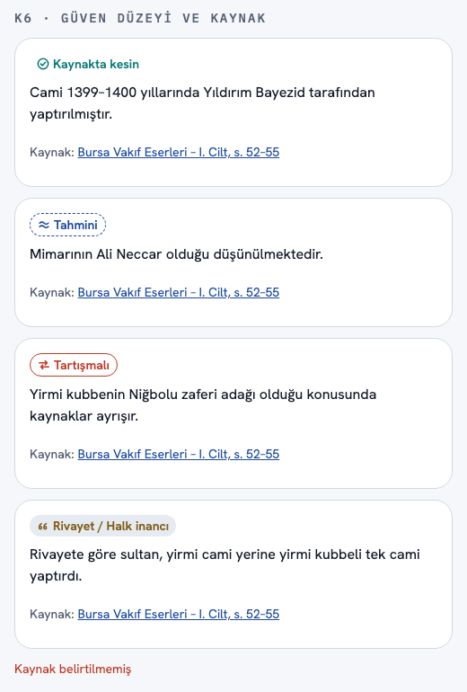
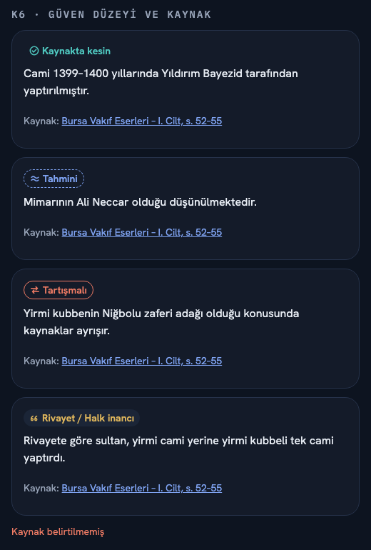

# Güven düzeyi ve kaynak gösterimi (K6)

Sorumlu: **Kübra Alkan** · Kullanan: eser detayı (Y9)

`/assets` sözleşmesinde her bilgi parçası (`sections`, `facts`, `timeline`, `founder`, `dating`) bir
`confidence` ve `sources` taşır. Bu belge ikisinin arayüzde nasıl gösterileceğini tanımlar. Bileşenler
`@vagabonds/ui` içinde hazır:

```tsx
import { ConfidenceBadge, SourceNote, legendVerdictLabel } from "@vagabonds/ui";

<ConfidenceBadge confidence={fact.confidence} />
<Text>{fact.value}</Text>
<SourceNote sources={fact.sources} />
```

| Açık tema | Koyu tema |
|---|---|
|  |  |

Görsellerdeki metinler örnektir; gerçek metinler ve rozet etiketleri API'den gelir.

## Rozetler

Rozetin metni API'nin gönderdiği `confidence.label`'dır (kullanıcının dilinde). Her düzey renkten başka
**ikon ve kenar biçimiyle** de ayrılır, bilgi yalnızca renge dayanmaz (WCAG 1.4.1).

| Kod | Etiket (tr) | İkon | Kenar | Renk rolü | Ne zaman |
|---|---|---|---|---|---|
| `certain` | Kaynakta kesin | ✓ halka | yok | `success` (firuze) | Varsayılan olarak **gösterilmez**; `showCertain` ile gösterilir (ör. karşılaştırma ekranları) |
| `probable` | Tahmini | ≈ | kesik çizgi | `primary` (kobalt) | Kaynak "düşünülmektedir, muhtemelen" diyor |
| `disputed` | Tartışmalı | ⇄ | düz çizgi | `warning` (mercan) | Kaynak birden fazla görüş veriyor |
| `legend` | Rivayet / Halk inancı | ❝ | dolgulu zemin | `highlight` (altın) | Rivayet, söylence; asla kesin bilgi gibi sunulmaz |

Kurallar:

- Rozet, ait olduğu bilginin **önünde** durur; ekran okuyucu önce rozeti duyar: "Güven düzeyi: Tahmini.
  Mimarının Ali Neccar olduğu düşünülmektedir." Rivayette "Bilgi türü: Rivayet / Halk inancı".
- `probable`, `disputed` ve `legend` her zaman gösterilir; sözleşme bunları düz bilgi gibi sunmayı yasaklıyor.
- Rivayetler (`legends[]`) tarih bölümlerinden ayrı, kendi başlığı altında listelenir. Her rivayet `legend`
  rozeti ve `legendVerdictLabel[verdict]` ile birlikte gösterilir:
  - `folk_belief`: Halk inancı
  - `refuted_by_source`: Kaynak bu anlatıyı doğrulamıyor
  - `unverified`: Kaynakla doğrulanmadı
- Bir bölümün tamamı tek düzeydeyse rozet bölüm başlığının altına bir kez konur, her paragrafa tekrar edilmez.

## Kaynak notu

`SourceNote`, bilginin altında küçük ikincil metin olarak durur:

- Tek kaynak: "Kaynak: Bursa Vakıf Eserleri – I. Cilt, s. 52–55"
- Birden fazla: "Kaynaklar:" ve her kaynak ayrı.
- `url` varsa kaynak bağlantıdır (44 pt dokunma alanı, altı çizili, `primary` renk).
- Ekran okuyucu "s." yerine "sayfa" duyar: "Bursa Vakıf Eserleri – I. Cilt, sayfa 52-55".
- Kaynak yoksa "Kaynak belirtilmemiş" uyarı renginde yazılır; bilgi gizlenmez ama kaynaksız olduğu görünür.

## Kontrast

Rozet ve kaynak renklerinin kullandığı her ön plan / arka plan çifti `npm run ui:contrast` ile denetlenir
(açık, koyu ve iki yüksek kontrast tema). En düşük çift: altın metin `altin700` / `gece100`, 4.82:1.
Tablo: [`packages/ui/CONTRAST.md`](../../packages/ui/CONTRAST.md).
