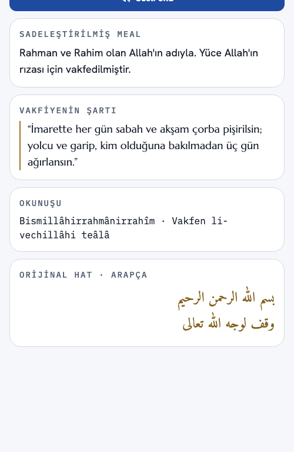
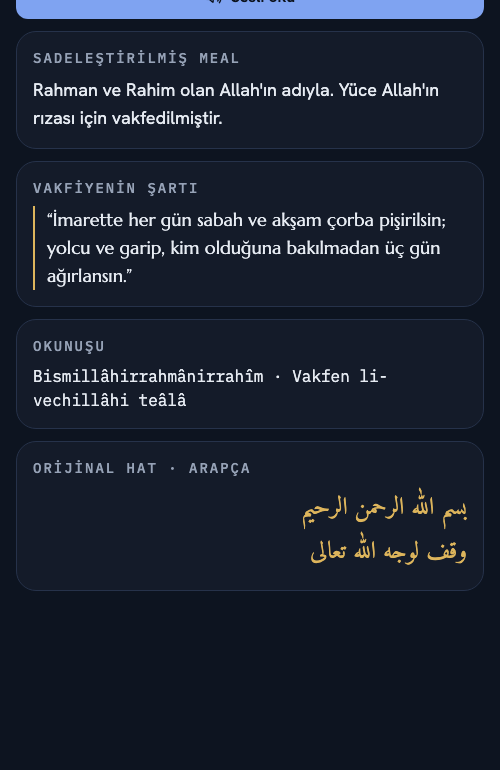

# Taşın Dili: kamerasız okuma (K7)

Sorumlu: **Kübra Alkan** · Ekran: `apps/app/src/app/inscription.tsx`, `components/inscription-reading.tsx`

Taşın Dili'nin kamera deneyimi (tarama → kilitlenme → kart) görmeyen, kamerayı kullanamayan ya da web'den
gelen kullanıcıya bir şey vermez. Kamerasız okuma modu aynı kitabeyi bir sayfa olarak sunar: okunur ya da
dinlenir.

| Açık tema | Koyu tema |
|---|---|
|  |  |

## Ne zaman açılır

| Durum | Açılan |
|---|---|
| Web | Her zaman okuma modu (kamera yok, [ADR 0001](../decisions/0001-universal-expo-app.md)) |
| Telefonda ekran okuyucu açık (VoiceOver, TalkBack) | Okuma modu. Kullanıcı isterse "Kamerayla tara" ile kameraya geçer |
| Telefon, ekran okuyucu kapalı | Kamera. Üst çubuktaki "Kamerasız oku" düğmesi okuma moduna geçirir |

Kamera modu, okuma modundan farklı olarak tema dışında her zaman karanlıktır. Okuma modu temayı izler; açık,
koyu ve yüksek kontrast temada okunur.

## Tel kafes

```
┌───────────────────────────────┐
│ (‹)  Geri                     │
│                               │
│ Taşın Dili                 H1 │
│ Muradiye Külliyesi · giriş    │
│ kapısının üzerindeki kitabe   │
│                               │
│ [ 🔊 Sesli oku ] [Kamerayla…] │   ← ikincisi yalnızca telefonda
│                               │
│ ┌ SADELEŞTİRİLMİŞ MEAL ─ H2 ┐ │
│ │ Rahman ve Rahim olan…     │ │
│ └───────────────────────────┘ │
│ ┌ VAKFİYENİN ŞARTI ───── H2 ┐ │
│ │ ┃ “İmarette her gün…”     │ │
│ └───────────────────────────┘ │
│ ┌ OKUNUŞU ────────────── H2 ┐ │
│ │ Bismillâhirrahmânirrahîm… │ │
│ └───────────────────────────┘ │
│ ┌ ORİJİNAL HAT · ARAPÇA  H2 ┐ │
│ │            بسم الله … (rtl) │ │
│ └───────────────────────────┘ │
└───────────────────────────────┘
```

## Ekran okuyucu okuma sırası

Görsel sıra ile okuma sırası aynıdır (WCAG 1.3.2, 2.4.3). Sıra, çoğu kullanıcının anlayabileceği şeyi öne alır:

1. **Geri** düğmesi
2. **"Taşın Dili"**: başlık, seviye 1
3. Kitabenin yeri: "Muradiye Külliyesi · giriş kapısının üzerindeki kitabe"
4. **"Sesli oku"** düğmesi: başta durur, kullanıcı tüm sayfayı gezmeden dinleyebilir. "Sesli mimari betimleme"
   ayarı kapalıysa görünmez.
5. (telefonda) **"Kamerayla tara"** düğmesi
6. **Sadeleştirilmiş meal**: başlık seviye 2, ardından Türkçe meal
7. **Vakfiyenin şartı**: başlık seviye 2, ardından alıntı
8. **Okunuşu**: başlık seviye 2, ardından Latin harfli okunuş
9. **Orijinal hat · Arapça**: başlık seviye 2, ardından Arapça metin. Dili işaretli (`language="ar"`: telefonda
   `accessibilityLanguage`, web'de `lang="ar" dir="rtl"`), ekran okuyucu Arapça sesle okur (WCAG 3.1.2).

Başlıklar arasında atlayan kullanıcı (rotor / başlık gezinmesi) dört bölümü doğrudan bulur.

Kamera modunda da aynı ilkeler geçerli: durum değişimleri ("Kitabe tanındı, hedef kilitli", "Kitabe çözüldü.
Meal ve vakfiye şartı aşağıda.") duyurulur, kart açılmadan önce ekran okuyucudan gizlidir, kart bölüm
başlıkları seviye 2'dir.

## "Sesli oku" metni

`inscriptionReadAloud`: "Kitabe." + meal + "Vakfiyenin şartı:" + şart. Arapça metin ve okunuş sesli okumaya
alınmaz; Türkçe ses motoru Arapçayı anlaşılır okuyamaz, okunuş da meali tekrar etmekten öteye geçmez.
